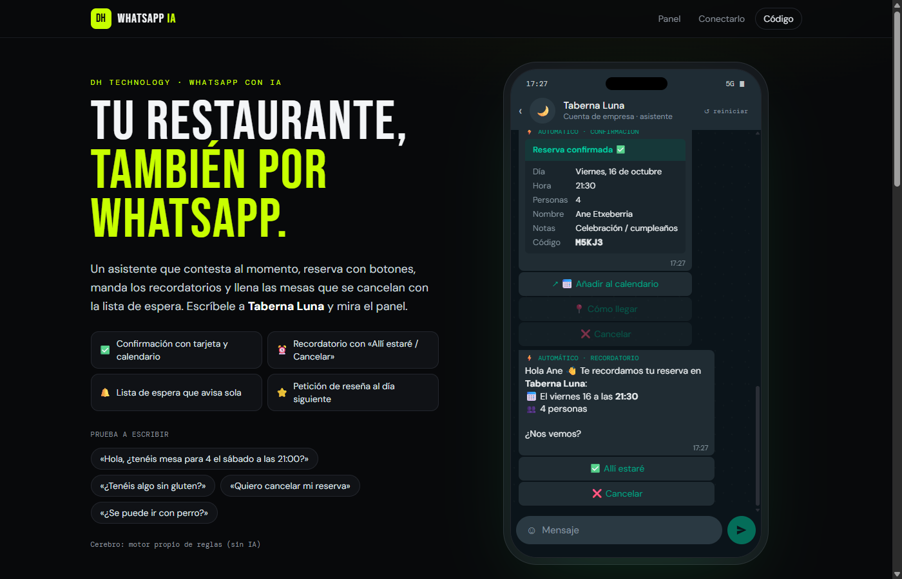
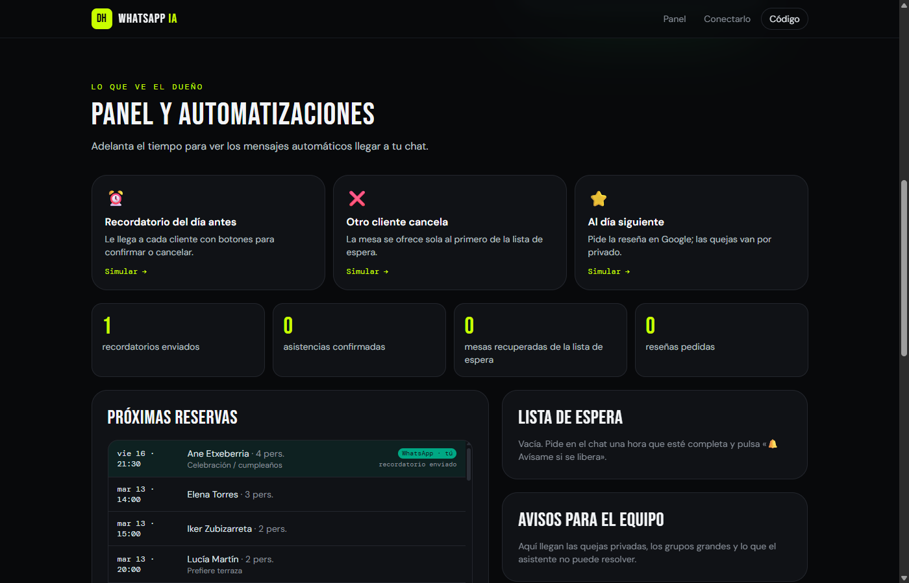

# WhatsApp IA para restaurantes

**Tu restaurante, también por WhatsApp.** Un asistente que contesta al momento, reserva con botones, manda los recordatorios y llena las mesas que se cancelan con la lista de espera.

**Pruébalo: [dht-whatsapp.vercel.app](https://dht-whatsapp.vercel.app)**. Escríbele a Taberna Luna y adelanta el tiempo desde el panel para ver llegar los mensajes automáticos.



## Qué hace

| | |
|---|---|
| **Reserva con botones** | Día, personas y hora con listas y botones de respuesta rápida de WhatsApp, o escribiéndolo todo de golpe: «mesa para 4 el viernes a las 21:30». Consulta las mesas libres de verdad, con el mismo motor que [Taberna Luna](https://github.com/hodeione/reservas-n8n). |
| **Tarjeta de confirmación** | Con el código, «Añadir al calendario» (.ics), «Cómo llegar» (ubicación) y «Cancelar». |
| **Recordatorio del día antes** | Con botones «✅ Allí estaré / ❌ Cancelar». Las asistencias confirmadas se marcan en el panel. Contra las mesas que se quedan vacías. |
| **Lista de espera automática** | Si la hora está completa, ofrece alternativas y «🔔 Avísame si se libera». Cuando alguien cancela, el primero de la lista recibe la mesa con un botón para quedársela. |
| **Reseñas** | Al día siguiente pide la reseña en Google. «Tuve un problema» abre un canal privado con el encargado, sin filtrar quién puede opinar. |
| **Dudas** | Carta completa con precios, alérgenos, horario, dirección, terraza o mascotas, siempre con los datos del negocio. |
| **Pasa al equipo** | Grupos grandes, quejas o lo que no sabe resolver llegan como aviso al panel. |



## Cómo funciona

```
WhatsApp (Meta o Twilio) ──► webhook ──► Conversación ──► motor ──► reservas
        ▲                                     │            │
        └──── botones, listas, tarjetas ◄─────┘    Claude Haiku 5.5
                                                   o reglas propias
```

- **Una sola lógica para la demo y para WhatsApp real.** `src/lib/chat.ts` convierte lo que espera el motor en botones y listas, y lleva las automatizaciones. La demo la ejecuta en el navegador; los webhooks, en una función de Vercel.
- **Dos cerebros.** Claude Haiku 5.5 con herramientas (disponibilidad, reservar, buscar, cancelar) y botones `[[…]]` en sus respuestas, o, sin clave, un motor de reglas propio que entiende fechas, horas y comensales en castellano. Si la IA falla, sigue el motor de reglas sin cortar.
- **WhatsApp Cloud API (Meta):** valida la firma `X-Hub-Signature-256`, responde 200 al momento y procesa en segundo plano (`waitUntil`). Ignora webhooks repetidos y envía botones de respuesta, listas, botón de enlace y ubicación nativos.
- **Twilio (sandbox de WhatsApp):** valida la firma de Twilio y responde en TwiML con las opciones numeradas («responde 1, 2 o 3»).
- **Escribir primero (recordatorios y reseñas):** un cron diario de Vercel (`/api/recordatorios`) usa plantillas aprobadas por Meta, con nuestras acciones en los botones (`#confirmar:CÓDIGO`).
- **Estado:** Upstash Redis por su API REST (sin dependencias) o, si no está, memoria de la instancia. Reservas: el sistema real de reservas-n8n o la ocupación de ejemplo.
- **91 pruebas:** conversaciones completas con botones, lista de espera de punta a punta, formatos de Meta (límites de 3 botones, 10 filas, 20 y 24 caracteres), firmas de Meta y Twilio, numeración de Twilio, servidor con Redis simulado y calendario firmado.

## Conectarlo a tu WhatsApp

**Opción rápida: Twilio Sandbox** (sin aprobación de Meta)
1. En Twilio, *Messaging → Try it out → WhatsApp* y únete al sandbox desde tu móvil.
2. En *Sandbox settings → When a message comes in*: `https://TU-DOMINIO/api/twilio` (POST).
3. Variable `TWILIO_AUTH_TOKEN`. Opcional, para avisos de lista de espera a otros números: `TWILIO_ACCOUNT_SID` y `TWILIO_WHATSAPP_FROM`.

**Opción oficial: WhatsApp Cloud API (Meta)**
1. Crea una app en developers.facebook.com con el producto WhatsApp y un número.
2. Webhook: `https://TU-DOMINIO/api/whatsapp`, con el token de verificación que elijas, suscrito a `messages`.
3. Variables: `WHATSAPP_VERIFY_TOKEN`, `WHATSAPP_APP_SECRET`, `WHATSAPP_TOKEN` y `WHATSAPP_PHONE_NUMBER_ID`.
4. Para recordatorios y reseñas, crea las plantillas `recordatorio_reserva` (4 variables y 2 botones de respuesta rápida) y `peticion_resena` (2 variables y 1 botón). Sus nombres se pueden cambiar con `WHATSAPP_PLANTILLA_RECORDATORIO` y `WHATSAPP_PLANTILLA_RESENA`.

**Común:** `UPSTASH_REDIS_REST_URL` y `UPSTASH_REDIS_REST_TOKEN` (estado persistente), `ANTHROPIC_API_KEY` (Claude), `RESERVAS_N8N_URL` y `RESERVAS_N8N_CLAVE` (reservas reales), `CRON_SECRET` y `ENLACES_SECRETO`.

## Ejecutarlo

```bash
npm install
npm run dev     # demo y funciones en local
npm test        # 91 pruebas
npm run build
```

---

Hecho por [DH Technology](https://h-com-bay.vercel.app). Taberna Luna es un restaurante de demostración. WhatsApp es una marca de Meta; este proyecto no está afiliado a Meta. Licencia MIT.
